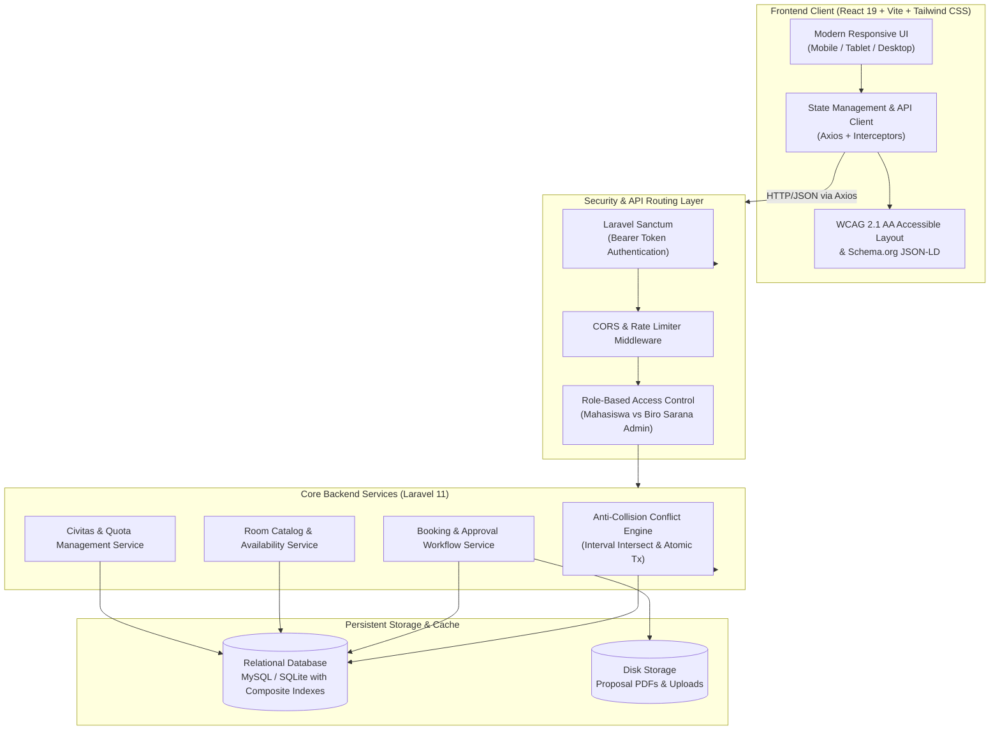

# Kumpul-In Kampus: Sistem Informasi Peminjaman Fasilitas & Ruangan Kampus Terpadu

[](https://laravel.com)
[](https://react.dev)
[](https://vitejs.dev)
[](https://tailwindcss.com)
[](https://phpunit.de)
[](https://www.w3.org/WAI/standards-guidelines/wcag/)

**Kumpul-In Kampus** adalah platform web enterprise terintegrasi yang dirancang khusus untuk memodernisasi tata kelola, perizinan, dan transparansi peminjaman fasilitas fisik di lingkungan perguruan tinggi. Platform ini menghubungkan seluruh civitas akademika (mahasiswa, dosen, ormawa, dan unit kegiatan kampus) dengan **Biro Sarana dan Prasarana Kampus** melalui sistem *real-time self-service* yang bebas biaya (non-komersial) dan bergaransi anti-bentrok (*zero-conflict scheduling*).

---

## 📑 Daftar Isi

- [1. Gambaran Umum & Solusi](#-1-gambaran-umum--solusi)
- [2. Arsitektur Sistem](#-2-arsitektur-sistem)
- [3. Fitur Utama & Modul](#-3-fitur-utama--modul)
  - [Portal Civitas Akademika](#a-portal-civitas-akademika-mahasiswa--ormawa)
  - [Command Center Biro Sarana (Admin)](#b-command-center-biro-sarana-kampus-administrator)
- [4. Mesin Validasi Anti-Bentrok (Mathematical Formulation)](#-4-mesin-validasi-anti-bentrok-mathematical-formulation)
- [5. Spesifikasi Teknologi (Tech Stack)](#-5-spesifikasi-teknologi-tech-stack)
- [6. Skema Basis Data & Entitas](#-6-skema-basis-data--entitas)
- [7. Dokumentasi REST API](#-7-dokumentasi-rest-api)
- [8. Panduan Instalasi & Menjalankan Sistem](#-8-panduan-instalasi--menjalankan-sistem)
- [9. Pengujian Otomatis (Test Suite)](#-9-pengujian-otomatis-test-suite)
- [10. Optimasi & Standar Kualitas (SEO, A11y, Performance)](#-10-optimasi--standar-kualitas-seo-a11y-performance)
- [11. Akun Pengujian Sistem](#-11-akun-pengujian-sistem)

---

## 📌 1. Gambaran Umum & Solusi

Peminjaman fasilitas kampus konvensional seringkali terkendala oleh surat menyurat birokratis yang lambat, ketidakpastian ketersediaan jadwal, verifikasi dokumen kegiatan yang tercecer, hingga insiden bentrok jadwal penggunaan aula atau ruang rapat (*double booking*). 

**Kumpul-In Kampus hadir memberikan solusi menyeluruh:**
1. **Transparansi Slot Waktu Real-Time:** Menampilkan matriks keterisian 10 sesi jam operasional (08:00 – 18:00 WIB) per tanggal secara akurat dan interaktif.
2. **Pencegahan Bentrok Deterministik:** Mengunci jadwal dengan isolasi transaksi basis data (*Database Atomic Transactions*) menggunakan formula interval matematika.
3. **Alur Verifikasi Bertingkat (*Two-Tier Approval Workflow*):** Peminjaman aula atau kegiatan mahasiswa diproses dengan status `pending` hingga diverifikasi oleh Biro Sarana, sedangkan reservasi dinas oleh staf Biro Sarana langsung terkonfirmasi otomatis (`confirmed`).
4. **Tata Kelola Kuota Adil (*Fair Quota Governance*):** Setiap mahasiswa memiliki kuota aktif (5 slot) yang terpotong saat pengajuan dan otomatis dipulihkan (*auto-refund*) jika reservasi dibatalkan atau ditolak.
5. **E-Voucher Sah & Bukti Digital:** Sistem otomatis menerbitkan voucher peminjaman berkode unik (format: `KMP-YYYYMMDD-XXXX`) yang dilengkapi *printer-friendly style* dan unduh berkas perizinan PDF.

---

## 🏗️ 2. Arsitektur Sistem

Kumpul-In Kampus dibangun dengan pola arsitektur **Decoupled Single Page Application (SPA) & RESTful API**, menjamin skalabilitas tinggi, pemisahan tanggung jawab (*Separation of Concerns*), serta efisiensi beban komputasi.



---

## ⚡ 3. Fitur Utama & Modul

### A. Portal Civitas Akademika (Mahasiswa & Ormawa)
* **Katalog Fasilitas Multikategori:** Menjelajahi fasilitas kampus dengan filter kategori (*Aula*, *Perpustakaan*, *Meeting Room*, *Ruang Belajar Mandiri*), filter kapasitas peserta, pencarian cepat, dan pengurutan kapasitas.
* **Kalender & Sesi Waktu Dinamis:** Pilihan tanggal instan (*Hari Ini*, *Besok*, *Lusa*) atau penanggalan kustom, dilengkapi indikator persentase keterisian jadwal.
* **Fleksibilitas Durasi:** Dukungan peminjaman per jam (*hourly*) maupun seharian penuh (*full-day 08:00 - 18:00 WIB*).
* **Upload Proposal Kegiatan Mandatori:** Sistem mewajibkan pelampiran dokumen proposal kegiatan / surat permohonan izin (format PDF) khusus untuk peminjaman kategori **Aula**.
* **Dashboard Peminjaman Pribadi:** Memantau riwayat reservasi lengkap dengan filter status (*Semua*, *Menunggu Verifikasi*, *Disetujui*, *Dibatalkan/Ditolak*), salin kode booking 1-klik, dan cetak voucher digital berstandar cetak printer/PDF.
* **Pembatalan Mandiri:** Mahasiswa dapat membatalkan permohonan atau reservasi yang belum berjalan, membebaskan kembali slot jadwal ke publik dan memulihkan kuota seketika.

### B. Command Center Biro Sarana Kampus (Administrator)
* **Executive Overview & KPI Cards:** 5 metrik analitik real-time (*Total Reservasi*, *Menunggu Verifikasi*, *Disetujui*, *Ruangan Aktif*, dan *Civitas Terdaftar*).
* **Attention Alert Banner:** Notifikasi menonjol saat terdapat antrean permohonan baru yang memerlukan tindakan verifikasi admin.
* **Manajemen & Verifikasi Peminjaman:**
  - Persetujuan (*Approve*) permohonan yang berstatus `pending`.
  - Penolakan (*Reject*) dengan pemulihan kuota otomatis ke akun mahasiswa.
  - Pembatalan (*Cancel*) reservasi terkonfirmasi dengan pengembalian slot ke publik.
  - Tinjau dan unduh berkas proposal perizinan mahasiswa langsung dari tabel log.
* **CRUD Kelola Fasilitas Ruangan:**
  - Tambah fasilitas baru dengan penetapan nama, kategori, dan kapasitas maksimal.
  - Edit identitas dan kapasitas fasilitas secara langsung.
  - Sakelar status aktif/nonaktif (*soft toggle*) untuk menandai ruangan dalam perawatan (*maintenance*).
  - Hapus fasilitas ruangan dari inventaris.
  - Filter pencarian dan status ketersediaan fasilitas.
* **CRUD Manajemen Pengguna Civitas:**
  - Pendaftaran akun staf admin baru atau mahasiswa secara administratif.
  - Edit nama, email, penyesuaian kuota booking, dan reset kata sandi.
  - Filter berdasarkan peran pengguna dan kuota booking.
  - Proteksi integritas: Admin dicegah menghapus akun miliknya sendiri (*self-deletion prevention*).

---

## 📐 4. Mesin Validasi Anti-Bentrok (Mathematical Formulation)

Untuk menjamin ketiadaan jadwal bentrok (*double booking*) bahkan ketika ratusan civitas mengakses sistem secara bersamaan (*race condition*), Kumpul-In menerapkan prinsip validasi matematis:

### Formulasi Interval Waktu
Dua sesi jadwal peminjaman pada ruangan yang sama dan tanggal yang sama dinyatakan **bentrok / bersinggungan** apabila memenuhi relasi logika:

$$\text{Conflict}(A, B) \iff (S_A < E_B) \land (E_A > S_B)$$

Dimana:
* $S_A$ dan $E_A$: Waktu mulai (*Start*) dan waktu selesai (*End*) dari jadwal yang diajukan.
* $S_B$ dan $E_B$: Waktu mulai dan waktu selesai dari reservasi yang sudah terdaftar dengan status `confirmed` atau `pending`.

### Mode Peminjaman Harian (*Daily Booking*)
Jika peminjaman eksisting atau peminjaman baru berjenis `daily` (seharian penuh):
$$\text{Conflict}_{\text{daily}} \iff \text{Date}_A = \text{Date}_B$$
Sistem secara otomatis mengunci seluruh 10 sesi jam pada hari tersebut.

### Eksekusi Database Atomic Transaction
Seluruh proses pengecekan konflik, pencatatan baris reservasi, dan pemotongan kuota dibungkus di dalam blok `DB::transaction()`:
```php
DB::transaction(function () use ($user, $room, $validated, ...) {
    $booking = Booking::create([...]);
    if ($user->role !== 'admin') {
        $user->decrement('booking_quota');
    }
    return $booking;
});
```
Jika terjadi kegagalan sistem atau interupsi koneksi di tengah jalan, status transaksi otomatis di-*rollback*, berkas proposal fisik dihapus dari disk, dan data tetap berada pada kondisi konsisten (*ACID compliance*).

---

## 💻 5. Spesifikasi Teknologi (Tech Stack)

### Backend
* **Framework:** Laravel 11.x
* **Bahasa Pemrograman:** PHP 8.2+
* **Otentikasi:** Laravel Sanctum (Stateful / Personal Access Token)
* **Basis Data:** MySQL 8.x / SQLite
* **Penyimpanan Berkas:** Local Public Disk Storage (Proposal PDF)
* **Testing Engine:** PHPUnit 11.x

### Frontend
* **Library Utama:** React 19 (SPA Architecture)
* **Build Tool & Bundler:** Vite 6.x
* **Styling & Design System:** Tailwind CSS v3.4 + `@tailwindcss/forms`
* **Iconography:** Lucide React
* **HTTP Client:** Axios (Interceptors terintegrasi untuk token Sanctum dan normalisasi error RFC 7807)
* **Formatters:** Native ECMAScript Intl API (Penanggalan Indonesia)

---

## 🗄️ 6. Skema Basis Data & Entitas

```
┌──────────────┐          ┌───────────────────┐          ┌──────────────┐
│    users     │ 1      N │     bookings      │ N      1 │    rooms     │
├──────────────┤──────────├───────────────────┤──────────├──────────────┤
│ id (PK)      │          │ id (PK)           │          │ id (PK)      │
│ name         │          │ booking_code (UQ) │          │ name         │
│ email (UQ)   │          │ user_id (FK)      │          │ category     │
│ password     │          │ room_id (FK)      │          │ capacity     │
│ role         │          │ booking_date      │          │ is_active    │
│ booking_quota│          │ start_time        │          │ timestamps   │
│ timestamps   │          │ end_time          │          └──────────────┘
└──────────────┘          │ duration_type     │
                          │ proposal_path     │
                          │ status            │
                          │ timestamps        │
                          └───────────────────┘
```

### Indeks Performa (Composite Indexes)
Untuk menjamin performa pencarian slot $O(\log N)$ pada jutaan baris data, tabel dilengkapi dengan indeks gabungan:
* `bookings`: `['room_id', 'booking_date', 'status']` (*Fast conflict resolution & slot filtering*)
* `bookings`: `['user_id', 'status']` (*Instant user history retrieval*)
* `rooms`: `['is_active', 'category']` (*Optimized public catalog filtering*)
* `users`: `['role']` (*Rapid administrative filtering*)

---

## 🔌 7. Dokumentasi REST API

Semua rute beroperasi pada base URL: `http://localhost:8000/api`

### A. Autentikasi & Akun
| Metode | Endpoint | Hak Akses | Deskripsi |
| :--- | :--- | :--- | :--- |
| `POST` | `/auth/login` | Publik | Masuk ke akun menggunakan email & kata sandi |
| `POST` | `/auth/register` | Publik | Registrasi mandiri akun civitas mahasiswa baru |
| `POST` | `/auth/quick-login` | Publik | Autentikasi 1-klik untuk pengujian peran (`mahasiswa` / `admin`) |
| `GET` | `/auth/me` | Sanctum | Mendapatkan data profil dan sisa kuota pengguna aktif |
| `POST` | `/auth/logout` | Sanctum | Mencabut token akses dan mengakhiri sesi |

### B. Fasilitas & Ketersediaan Slot
| Metode | Endpoint | Hak Akses | Deskripsi |
| :--- | :--- | :--- | :--- |
| `GET` | `/rooms` | Publik | Katalog ruangan dengan parameter `category` dan `min_capacity` |
| `GET` | `/rooms/{id}/availability` | Publik | Cek status ketersediaan 10 sesi jam pada tanggal tertentu (`?date=YYYY-MM-DD`) |

### C. Reservasi & Peminjaman Civitas
| Metode | Endpoint | Hak Akses | Deskripsi |
| :--- | :--- | :--- | :--- |
| `GET` | `/bookings` | Sanctum | Mengambil daftar seluruh reservasi milik pengguna aktif |
| `POST` | `/bookings` | Sanctum | Mengajukan peminjaman (validasi bentrok, potong kuota, simpan proposal PDF) |
| `PATCH` | `/bookings/{id}/cancel` | Sanctum | Membatalkan peminjaman milik sendiri dan mengembalikan kuota 1 slot |
| `GET` | `/bookings/proposal/{code}` | Publik | Mengunduh berkas proposal permohonan berformat PDF |

### D. Pusat Kendali Biro Sarana (Admin)
| Metode | Endpoint | Hak Akses | Deskripsi |
| :--- | :--- | :--- | :--- |
| `GET` | `/admin/stats` | Admin | Ringkasan statistik performa fasilitas dan reservasi kampus |
| `GET` | `/admin/bookings` | Admin | Seluruh log riwayat peminjaman dengan filter status dan tanggal |
| `PATCH`| `/admin/bookings/{id}/status` | Admin | Verifikasi status peminjaman (`confirmed`, `rejected`, `cancelled`) |
| `POST` | `/admin/rooms` | Admin | Mendaftarkan fasilitas ruangan baru ke dalam sistem |
| `PATCH`| `/admin/rooms/{id}` | Admin | Memperbarui atribut fasilitas atau sakelar status aktif/nonaktif |
| `DELETE`|`/admin/rooms/{id}` | Admin | Menghapus data fasilitas ruangan |
| `GET` | `/admin/users` | Admin | Daftar seluruh pengguna civitas dengan filter peran dan pencarian |
| `POST` | `/admin/users` | Admin | Menambahkan akun pengguna baru secara manual |
| `PATCH`| `/admin/users/{id}` | Admin | Memperbarui data civitas, penyesuaian kuota, atau reset sandi |
| `DELETE`|`/admin/users/{id}` | Admin | Menghapus akun pengguna civitas (terproteksi anti-self deletion) |

---

## 🚀 8. Panduan Instalasi & Menjalankan Sistem

### Prasyarat Perangkat Lunak
* **PHP:** Versi 8.2 atau lebih baru (dengan ekstensi `pdo`, `sqlite3` atau `pdo_mysql`, `mbstring`, `fileinfo`)
* **Composer:** Versi 2.x
* **Node.js:** Versi 18.x atau 20.x LTS
* **Package Manager:** npm atau pnpm

---

### Langkah 1: Setup Backend API (Laravel 11)

1. Masuk ke direktori backend:
   ```bash
   cd backend
   ```
2. Instal dependensi PHP:
   ```bash
   composer install
   ```
3. Salin file environment:
   ```bash
   cp .env.example .env
   ```
4. Generate application key:
   ```bash
   php artisan key:generate
   ```
5. Buat symlink storage untuk berkas proposal:
   ```bash
   php artisan storage:link
   ```
6. Jalankan migrasi basis data dan seeding data fasilitas:
   ```bash
   php artisan migrate --seed
   ```
   *(Secara default backend menggunakan SQLite yang otomatis siap pakai, atau Anda dapat mengonfigurasi koneksi MySQL pada file `.env`)*
7. Jalankan server backend:
   ```bash
   php artisan serve --port=8000
   ```
   Backend aktif pada: **`http://127.0.0.1:8000`**

---

### Langkah 2: Setup Frontend Client (React 19 Vite)

1. Buka terminal baru dan masuk ke direktori frontend:
   ```bash
   cd frontend
   ```
2. Instal dependensi Node.js:
   ```bash
   npm install
   ```
3. Jalankan server pengembangan Vite:
   ```bash
   npm run dev
   ```
   Frontend aktif pada: **`http://localhost:5173`**

---

## 🧪 9. Pengujian Otomatis (Test Suite)

Platform Kumpul-In dilengkapi dengan rangkaian pengujian integrasi dan fitur otomatis menyeluruh (*Unit & Feature Tests*) mencakup seluruh skenario operasional:

```bash
cd backend
php artisan test
```

### Hasil Verifikasi Pengujian (100% Lolos):
```text
   PASS  Tests\Unit\ExampleTest
  ✓ that true is true

   PASS  Tests\Feature\ExampleTest
  ✓ the application returns a successful response

   PASS  Tests\Feature\KumpulinApiTest
  ✓ can list rooms with filters
  ✓ can check room availability including seeded booking
  ✓ quick login returns token
  ✓ mahasiswa can create hourly booking and quota decrements
  ✓ conflict detection prevents double booking
  ✓ aula booking requires proposal file
  ✓ mahasiswa can book daily with proposal for aula
  ✓ user can register new account
  ✓ admin can access dashboard stats and manage bookings
  ✓ user can cancel own booking and recover quota
  ✓ registration fails if password confirmation mismatches
  ✓ non admin cannot access admin stats
  ✓ admin can book rooms
  ✓ admin can manage users crud
  ✓ admin cannot delete self
  ✓ mahasiswa booking starts with pending status awaiting approval
  ✓ admin can approve pending booking
  ✓ admin can reject pending booking and refund quota
  ✓ pending booking locks slot and prevents conflict

  Tests:    21 passed (96 assertions)
  Duration: 0.83s
```

---

## 🌟 10. Optimasi & Standar Kualitas (SEO, A11y, Performance)

1. **Aksesibilitas (WCAG 2.1 AA):**
   - Struktur dokumen semantik HTML5 (`<main>`, `<header>`, `<nav>`, `<aside>`, `<section>`, `<article>`).
   - Ukuran target interaksi minimal $44 \times 44\text{ px}$ untuk kemudahan akses di layar sentuh ponsel.
   - Dukungan penuh navigasi keyboard (`Tab`, `Enter`, `Space`, `Escape` untuk menutup modal).
   - Label atribut ARIA yang lengkap (`aria-modal`, `aria-expanded`, `aria-label`, `aria-pressed`).
2. **SEO & Agentic Browsing:**
   - Standar `robots.txt` ramah mesin pencari dan agen AI otonom (*GPTBot, PerplexityBot, ClaudeBot*).
   - Sitemap canonical XML (`sitemap.xml`) mencakup seluruh indeks rute publik.
   - Skema terstruktur **JSON-LD Schema.org** `@graph` bertipe `WebApplication`, `EducationalOrganization`, dan `Service` dengan spesifikasi `ReserveAction` agar AI crawler dapat memahami kapabilitas peminjaman secara langsung.
3. **PWA Readiness:**
   - Dilengkapi `site.webmanifest` dengan skema warna institusi `#326273`.
4. **Performa:**
   - Waktu kompilasi produksi Vite hanya **~1.4 detik**.
   - Proyeksi kolom database efisien dan agregasi statistik tunggal (*3 unified queries vs 7 sequential queries*).
   - Indeks komposit basis data untuk eksekusi pencarian slot instan.

---

## 👥 11. Akun Pengujian Sistem

Untuk kemudahan demonstrasi sistem, database seeder telah menyediakan akun siap pakai:

| Peran Sistem | Alamat Email | Kata Sandi | Kuota Peminjaman | Hak Akses Khusus |
| :--- | :--- | :--- | :---: | :--- |
| **Biro Sarana (Admin)** | `admin@kumpulin.test` | `password` | Tanpa Batas (999) | Akses Dashboard Admin, CRUD Fasilitas, CRUD Pengguna, Verifikasi Persetujuan |
| **Civitas Mahasiswa** | `mahasiswa@kumpulin.test` | `password` | 5 Slot | Katalog Fasilitas, Pengajuan Peminjaman, Unggah Proposal Aula, Pembatalan Kuota |

*(Catatan: Anda juga dapat menggunakan form registrasi publik untuk mendaftarkan akun mahasiswa baru, atau menggunakan fitur **Masuk Cepat Pengujian 1-Klik** di dalam modal login).*

---

## 📄 Lisensi

Platform Kumpul-In Kampus didistribusikan di bawah lisensi terbuka [MIT License](LICENSE). Seluruh civitas akademika bebas menggunakan, mengembangkan, dan menyesuaikan sistem ini untuk kebutuhan fasilitas institusi masing-masing.
